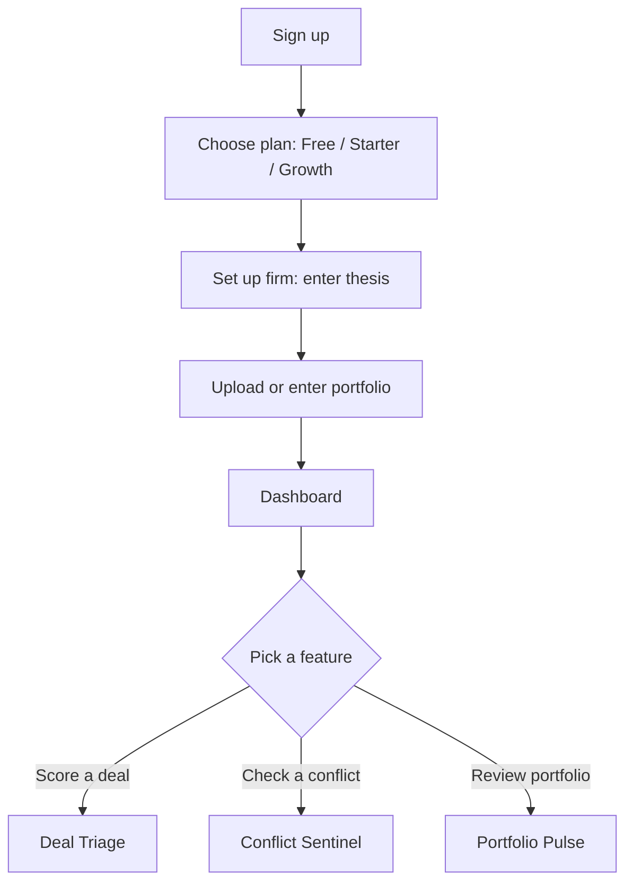
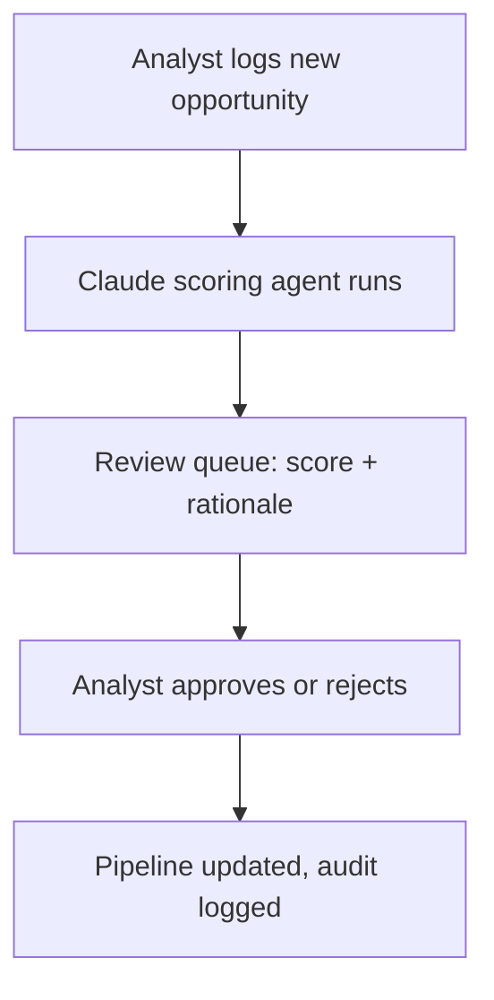
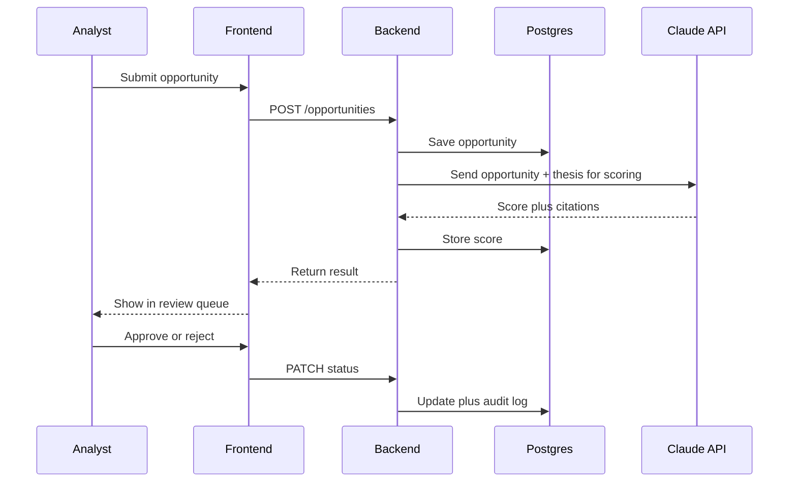
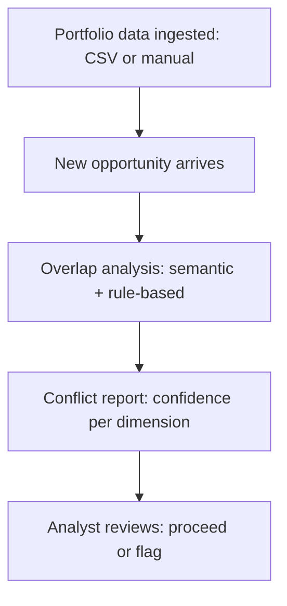
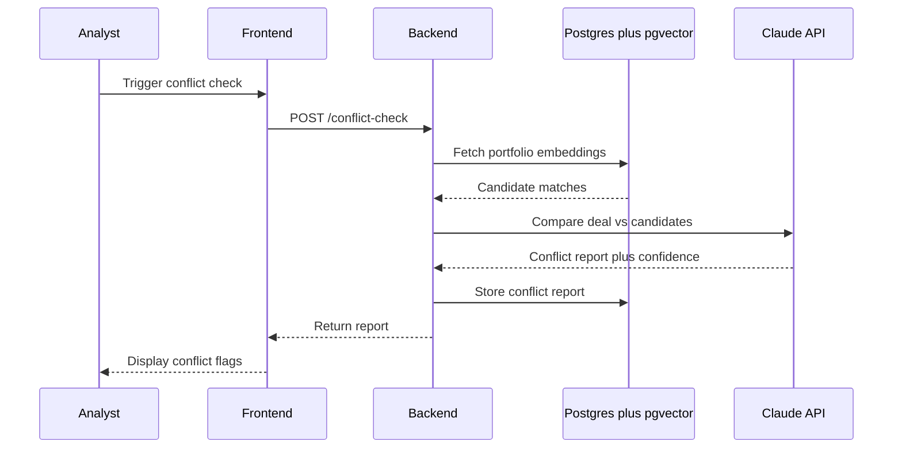
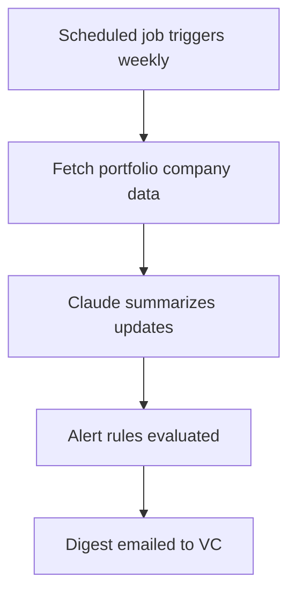
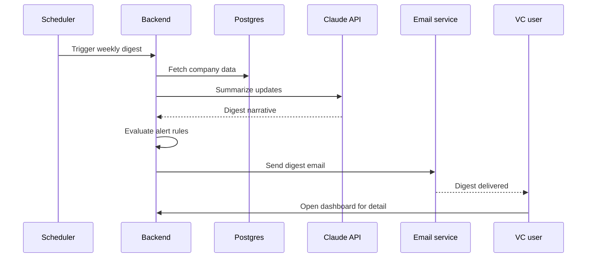
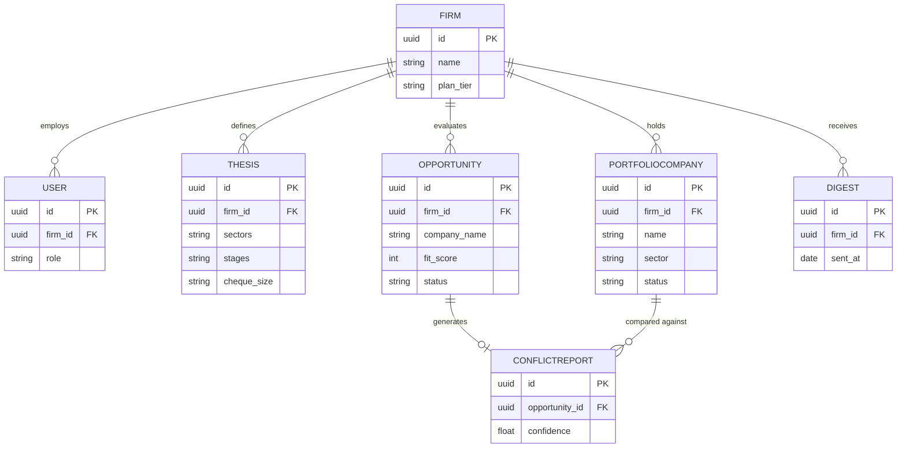

# App Flow & Auth Flow

This file combines two documents that were kept separately, with no content removed:

- **Part 1 — App Flow Specification** (formerly `app-flow-spec-narrow-build.md`): the product flow for
  the narrow build — Deal Triage, Conflict Sentinel and Portfolio Pulse.
- **Part 2 — Auth Flow Audit** (formerly `AUTH_FLOW_CHECK.md`): the checklist and agent instructions
  for auditing login, registration, roles, sessions and logout.

For how sessions work and how to test them in this codebase, see `TESTING.md`.

---

# Part 1 — App Flow Specification

## App Flow Specification — VC Deal-Ops Platform (Narrow Build)

**Scope:** Deal Triage · Conflict Sentinel · Portfolio Pulse — VC-side only, web-first, on the existing Spring Boot monolith
**Source of scope:** Business Case v1.0 (22 July 2026), Sections 6, 7 and 10.2
**Supersedes:** the two-sided mutual-consent flow described in the April 2026 PRD v1.0 and Visual Companion — that flow is out of scope for this build

---

### 0. What this document is, and isn't

None of the five source documents (Validation Research, PRD v1.0, Visual Companion, Business Case) contain flow-level detail for this narrowed 3-feature scope. The Business Case describes *what* to build and in what order (Section 10.2) but not *how a user moves through it* screen by screen, or what each AI agent's inputs/outputs/tools are.

This document fills that gap. Everything below is newly constructed from:
- The feature descriptions in Business Case §6.1
- The build sequence and entity list in Business Case §10.2 (Foundation → Deal Triage → Conflict Sentinel → Portfolio Pulse → Billing)
- The AI Agent Specification *format* from PRD v1.0 §11 (When / Inputs / Outputs / Tools) — reused here because it is implementation-ready, not because the original agents are in scope

Anything not stated in the Business Case (exact alert thresholds, exact confidence-scoring method, etc.) is flagged as an open question in Section 8, not invented.

---

### 1. Foundation — before any feature works

Per Business Case §10.2, weeks 9–11:

- **Auth:** Self-serve sign-up. No external verification step (this build has no SEBI/SEC-style KYC — that was original-PRD scope only).
- **Roles:** Two only — **Owner**, **Member**. Not the five-role matrix (Owner/PM/Staff/Founder/Co-founder) from the original PRD.
- **Tenancy:** Every account is one Firm. Isolation enforced at the service layer.
- **Audit log:** Every write action is logged, immutable.
- **Storage:** Postgres with pgvector (for the embeddings Conflict Sentinel needs).

---

### 2. App-level flow

No such flow existed anywhere in the source documents for this scope — this is new.

Notes:
- Thesis capture (step C) and portfolio ingestion (step D) are both required setup — Deal Triage can't score without a thesis, Conflict Sentinel can't compare without a portfolio.
- The Dashboard is a single unified view (not role-specific) since there are only two roles and three features.

---

### 3. Feature: Deal Triage

#### 3.1 User flow

#### 3.2 Technical sequence

#### 3.3 Agent spec

| | |
|---|---|
| **When** | Runs automatically on every new opportunity intake. On-demand re-score available. |
| **Inputs** | Opportunity details (company info, stage, sector, ask); firm's thesis (sectors, stages, cheque size) |
| **Outputs** | Fit score (0–100); short cited rationale; recommended action (pursue / pass / needs more info) |
| **Tools** | `thesis.match()`, `opportunity.get()`, `score.cite()` |

---

### 4. Feature: Conflict Sentinel

#### 4.1 User flow

#### 4.2 Technical sequence

#### 4.3 Agent spec

| | |
|---|---|
| **When** | Triggered manually before a new investment decision, per Business Case §6.1 |
| **Inputs** | Candidate company details; current portfolio (ingested via CSV or manual entry — no Carta integration in this build) |
| **Outputs** | Conflict report: sector overlap, customer overlap, competitive-product overlap, each with a confidence score |
| **Tools** | `portfolio.embed()`, `portfolio.compare()`, `overlap.score()` |

**Open question (not specified anywhere in the source docs):** whether the confidence score is shown per-dimension or as one blended number. Flag for the discovery interviews.

---

### 5. Feature: Portfolio Pulse

#### 5.1 User flow

#### 5.2 Technical sequence

#### 5.3 Agent spec

| | |
|---|---|
| **When** | Weekly scheduled job. On-demand button also available. |
| **Inputs** | Portfolio company records; latest status/metrics entered by the fund |
| **Outputs** | Markdown digest: per-company status, alerts, plain-English summary |
| **Tools** | `portfolio.get()`, `alerts.evaluate()`, `digest.compose()` |

**Open question:** exact alert-rule thresholds (e.g., what counts as "stale data" or a metric "decline") are not specified in the Business Case — needs a founder decision before this ships.

---

### 6. Data model (scoped to this build only)

This is deliberately smaller than the original PRD's data model — no `Like`, `Match`, `Message`, `PoolEntry`, `Wishlist`, or `Event` entities, because none of those concepts exist in the narrowed build.

---

### 7. Explicitly out of scope for this flow

Per Business Case §6.3, deferred until the reinstatement triggers listed there are met:

- Mutual-consent matching (the Like → Match state machine from the original PRD)
- Founder-side app entirely
- Native iOS / Android apps
- Multi-role RBAC (PM, Staff, Founder, Co-founder)
- Pool of companies / market database

If any of these get reinstated later, the flows in this document need to be re-scoped — they currently assume none of them exist.

---

### 8. Open questions (genuinely undecided, not just deferred)

1. Conflict Sentinel: per-dimension confidence display, or one blended score?
2. Portfolio Pulse: exact alert-rule thresholds for "decline" or "stale."
3. Deal Triage: does the review queue support bulk approve/reject, or one-at-a-time only?
4. None of the source documents specify what happens to an opportunity after "needs more info" — does it re-enter the queue, or wait for manual follow-up?

These need a founder decision, not more research — they weren't addressed in the discovery-interview plan either.

---

# Part 2 — Auth Flow Audit

## Auth Flow Audit — Login & Registration

### Purpose
This file instructs an AI coding agent (Claude Code) to audit the authentication
flow (login, registration, roles, session, logout) of whatever codebase it is
currently working in. It is stack-agnostic — the checks don't care if you're on
React or Vue, Spring or Express. What they DO branch on is the *auth pattern*
in use (credential-based / OAuth / delegated provider / passwordless), because
that's what actually changes where the real risks live.

### Severity legend
`[C]` Critical — security/data-integrity risk, fix before shipping
`[H]` High — real user-facing or security gap, fix soon
`[M]` Medium — worth fixing, not urgent
`[L]` Low — polish / nice-to-have

---

### 0. Project context (fill in, or let Claude Code infer it)
- Frontend stack:
- Backend stack:
- Auth pattern(s) in use (credential / OAuth-SSO / delegated provider / passwordless):
- Delegated provider, if any (Auth0 / Clerk / Firebase Auth / Supabase Auth / NextAuth):
- Roles / tenancy model (single role / multiple roles / multi-tenant / none):
- Token storage location (localStorage / cookie / memory):

---

### 1. Agent instructions
- Read this whole file before starting.
- Locate every file touching auth: search for `login`, `signup`, `register`,
  `auth`, `session`, `token`, `password`, `role`, `permission`.
- **Detect the auth pattern(s) actually present** before running Section 3 —
  don't run every pattern branch against every codebase. If it's Auth0/Clerk/
  Firebase/Supabase, most credential-hashing/token-signing items become N/A
  because that's the provider's job — instead verify the app correctly trusts
  and validates what the provider returns.
- **Detect whether the app has multiple roles or tenants** — if registration,
  login, or authorization branches by role in any way, run Section 2G in full;
  otherwise mark it N/A.
- Trace the full flow end-to-end: UI form → API endpoint → controller/handler →
  service layer → DB layer → response → client-side handling.
- This is an **audit pass, not a fix pass** — do not modify code unless
  explicitly asked to in a follow-up.
- For every item, mark `✅ Pass` / `⚠️ Partial` / `❌ Fail` / `➖ N/A`, with a
  file:line reference and a one-line reason.
- Output the final result as the table in Section 4. Rank "Top priority fixes"
  by severity tag first (all `[C]` fails before any `[H]`), not by file order
  or gut feel.
- If something looks wrong but isn't on the checklist, flag it under
  "Additional findings" — this list is a floor, not a ceiling.

---

### 2. Universal baseline (always run, regardless of auth pattern)

#### A. Input validation
- [ ] `[H]` Email format validated on both client and server
- [ ] `[H]` Password complexity enforced server-side, not just in the UI
- [ ] `[M]` Empty/missing field handling on both ends
- [ ] `[C]` Duplicate email or username checked on registration
- [ ] `[M]` Input trimmed/normalized (no silent match failures from whitespace)

#### B. Security
- [ ] `[C]` Passwords hashed with bcrypt/argon2/scrypt — never plain or reversibly encrypted
- [ ] `[C]` No password/token values ever written to logs or console
- [ ] `[C]` JWT/session secret pulled from env/config, not hardcoded
- [ ] `[H]` Token expiry set and enforced server-side
- [ ] `[H]` Refresh token rotation in place, if refresh tokens are used
- [ ] `[H]` Rate limiting or lockout on the login endpoint
- [ ] `[H]` CSRF protection present if using cookie-based auth
- [ ] `[C]` Queries parameterized / via ORM — no string-concatenated SQL
- [ ] `[H]` Auth cookies (if used) are `HttpOnly`, `Secure`, correctly scoped
- [ ] `[C]` CORS is not `*` combined with `credentials: true`

#### C. API / backend correctness
- [ ] `[M]` Correct status codes (200/201, 400, 401, 409 on duplicate, 500 only for real errors)
- [ ] `[M]` Consistent error response shape across all auth endpoints
- [ ] `[H]` No stack traces or internal error detail leaked to the client
- [ ] `[H]` Double-submitting registration doesn't create duplicate accounts

#### D. Frontend / UX
- [ ] `[L]` Loading state shown while a request is in flight
- [ ] `[M]` Error messages specific enough to act on, not a raw API dump
- [ ] `[M]` Clear success feedback / redirect after login and registration
- [ ] `[M]` Submit disabled/debounced during request — no double-submit
- [ ] `[L]` Form doesn't wipe entered data when a request fails

#### E. Session / state management
- [ ] `[H]` Auth state survives a page refresh correctly
- [ ] `[H]` Logout clears all auth state, client-side and server-side if sessions are used
- [ ] `[C]` Protected routes redirect unauthenticated users to login
- [ ] `[L]` Already-authenticated users redirected away from login/register pages

#### F. Edge cases
- [ ] `[H]` Wrong password → generic "invalid credentials" message (flag if the
  app reveals whether the *email* specifically exists — user-enumeration leak)
- [ ] `[H]` Registering an already-used email → clear error, no duplicate row
- [ ] `[M]` Network/API failure mid-request → graceful error, no infinite spinner
- [ ] `[H]` Expired or tampered token → forces re-login, doesn't crash the app

#### G. Multi-role / multi-tenant access (run only if roles/tenants detected)
- [ ] `[C]` Role is assigned from a trusted server-side source at registration —
  the client cannot set its own role via request body/form field tampering
- [ ] `[C]` Every role-restricted backend endpoint checks the role server-side —
  hiding a button/route on the frontend is never the only gate
- [ ] `[H]` If role is embedded in a JWT, a role change mid-session either
  invalidates the old token or the backend re-checks role from the DB,
  not just from token claims
- [ ] `[H]` New registrations default to least privilege — elevated roles
  (admin, staff, etc.) require an explicit invite/approval path
- [ ] `[C]` Endpoints that change a user's role are themselves role-protected
- [ ] `[M]` Behavior is defined and correct for one email holding multiple
  roles, if the product allows that (vs. one role per account)
- [ ] `[M]` Attempting to access another role's resource/dashboard returns a
  clean 403 — no leaking of what endpoints or data exist behind it
- [ ] `[L]` Post-login redirect sends each role to the correct dashboard/landing page

---

### 3. Pattern-specific checks (run only the branch(es) detected in Section 0/1)

#### P1. Credential-based auth (email + password, self-managed)
- [ ] `[C]` Password reset tokens are single-use and time-limited
- [ ] `[C]` Password reset request doesn't reveal whether the email exists
  (same response either way)
- [ ] `[H]` Old password/session invalidated after a successful password reset
- [ ] `[M]` Email verification token is single-use and time-limited, if present
- [ ] `[M]` Unverified accounts have clearly defined, enforced limits on what they can do

#### P2. OAuth / social login (Google, GitHub, etc.)
- [ ] `[C]` Redirect URIs are allowlisted, not accepted dynamically
- [ ] `[C]` `state` parameter (or PKCE) validated to prevent CSRF on the callback
- [ ] `[C]` Identity is verified via the provider's token/userinfo endpoint
  server-side — never trusted purely from client-supplied data
- [ ] `[M]` Account linking behavior is defined: what happens if the OAuth
  email matches an existing password-based account?

#### P3. Delegated auth provider (Auth0 / Clerk / Firebase Auth / Supabase Auth / NextAuth)
- [ ] `[C]` App verifies the provider's session/token server-side on protected
  requests — not just trusting a client-side "logged in" flag
- [ ] `[H]` Provider webhook/callback endpoints (user created, role changed, etc.)
  verify signatures, not just payload contents
- [ ] `[M]` Provider-side role/claims sync correctly to your app's own role model,
  if you maintain one separately
- [ ] `[L]` Provider dashboard config (allowed callback URLs, session length) matches
  what the app expects — mismatches here are a common source of silent bugs

#### P4. Passwordless (magic link / OTP)
- [ ] `[C]` Link/code is single-use and expires quickly (minutes, not hours)
- [ ] `[H]` Rate limiting on OTP/link requests to prevent spam or brute-force
- [ ] `[M]` Used or expired link/code shows a clear error, not a silent failure

---

### 4. Report format
Output as:

**Auth pattern(s) detected:**
**Roles/tenancy model detected:**

| Category | Item | Severity | Status | Location (file:line) | Notes / suggested fix |
|---|---|---|---|---|---|

Followed by:
- **Summary** — counts by severity and status
- **Top priority fixes** — all `[C]` fails first, then `[H]`, etc.
- **Additional findings** — anything relevant not covered above

### 5. Definition of done
Audit is complete when every applicable item in Sections 2–3 has a status and
location reference, and Section 4's report has been produced in full.
